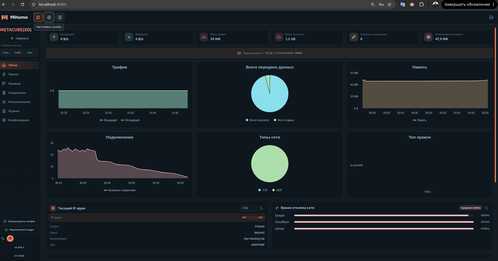

# mihomo-net

Веб-панель и systemd-интеграция для прокси-сервиса [Mihomo](https://github.com/MetaCubeX/mihomo).
Прозрачный прокси (TProxy + NFTables), режим шлюза для локальной сети,
транзакционное обновление подписки с автоматическим откатом.

[](LICENSE)


---

## Возможности

- **Развёртывание одной командой** — обнаружение удалённой системы, кросс-компиляция, установка ядра Mihomo и панели MetaCubeXD
- **Прозрачный прокси** — TProxy и перенаправление трафика через NFTables
- **Режим бокового роутера** — сервер как шлюз для устройств локальной сети
- **Умное разделение трафика** — обход китайских и российских IP, разделение DNS, управление QUIC
- **Веб-панель управления** — статус, журналы в реальном времени, настройки, обновление подписки
- **Транзакционное обновление** — предварительная проверка, 5-секундная проверка Google, автоматический откат при сбое
- **Автообновление** — cron для конфигурации, правил и IP-диапазонов
- **Интеграция с systemd** — управление службами, автозапуск при загрузке
- **Отказоустойчивая загрузка** — DoH, кэш DNS-предпочтений, атомарная запись файлов

---

## Скриншоты

| Панель управления | Состояние прокси |
|---|---|
|  |  |

---

## Требования

| Компонент | curl | grep | awk | jq | sudo | tar | nft | yq |
|---|---|---|---|---|---|---|---|---|
| Версия | ≥ 7.62 (для DoH) | любая | любая | любая | любая | любая | любая | mikefarah v4 |

### Debian / Ubuntu
```bash
apt update && apt install -y curl jq sudo tar nftables
```

### CentOS / RHEL / Fedora
```bash
yum install -y curl jq sudo tar nftables
```

### yq (Go-версия)
```bash
wget https://github.com/mikefarah/yq/releases/latest/download/yq_linux_amd64 \
  -O /usr/local/bin/yq && chmod +x /usr/local/bin/yq
```

Требуется ядро Linux **3.2+** и работающий **systemd**.

---

## Быстрый старт

### 1. Подготовка на машине разработчика

```bash
git clone https://github.com/smg38/mihomo-net.git
cd mihomo-net
# https://mise.jdx.dev/getting-started.html
mise trust
mise install
cp .env.template .env
```

В `.env` укажите:
- `CONFIG_URL` — ссылку на подписку
- `MIHOMO_SECRET` — ключ панели управления
- `REMOTE_USER`, `REMOTE_HOST`, `REMOTE_DIR` — куда публиковать

### 2. Публикация на сервер

```bash
mise run publish -- --build-only   # только обнаружение и локальная сборка
mise run publish                   # обнаружение, сборка, загрузка, установка
mise run publish -- --force        # пропустить восстановление старой публикации
```

### 3. Доступ к панели

```
http://<IP-сервера>:8000
```

---

## Документация

| Документ | Содержание |
|---|---|
| [docs/deployment.md](docs/deployment.md) | Публикация, транзакции, откат, режим `--force` |
| [docs/configuration.md](docs/configuration.md) | `.env`, переопределения конфигурации, провайдеры |
| [docs/http-download.md](docs/http-download.md) | DoH, кэш DNS-предпочтений, прогресс загрузки |
| [docs/cli-cron.md](docs/cli-cron.md) | `update.sh`, коды выхода, cron |
| [docs/recovery.md](docs/recovery.md) | Точки восстановления, `.update-state/` |
| [docs/api.md](docs/api.md) | HTTP-эндпоинты менеджера |
| [docs/clients.md](docs/clients.md) | Импорт подписки на клиентах |
| [docs/architecture.md](docs/architecture.md) | Структура проекта и компоненты |
| [docs/troubleshooting.md](docs/troubleshooting.md) | Устранение неполадок |
| [docs/development.md](docs/development.md) | `mise`, тесты, локальная сборка, приёмка |

---

## Лицензия

[MIT](LICENSE)

## Благодарности

- [MetaCubeX/mihomo](https://github.com/MetaCubeX/mihomo) — ядро прокси
- [MetaCubeX/metacubexd](https://github.com/MetaCubeX/metacubexd) — веб-панель
- [Tabler Icons](https://tabler.io/icons) — иконки интерфейса