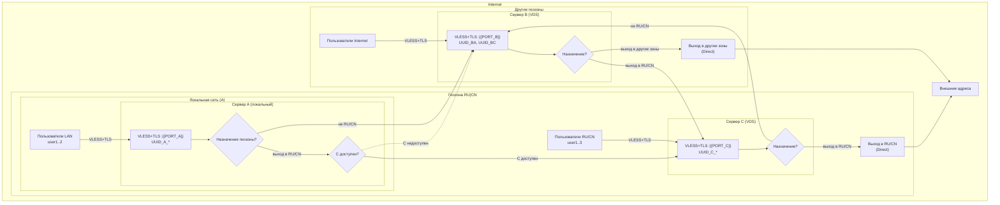
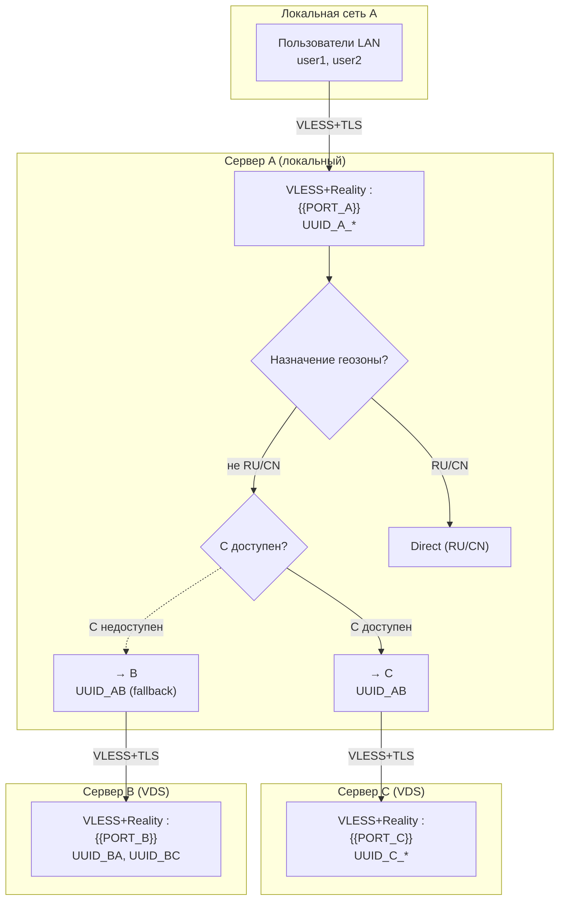
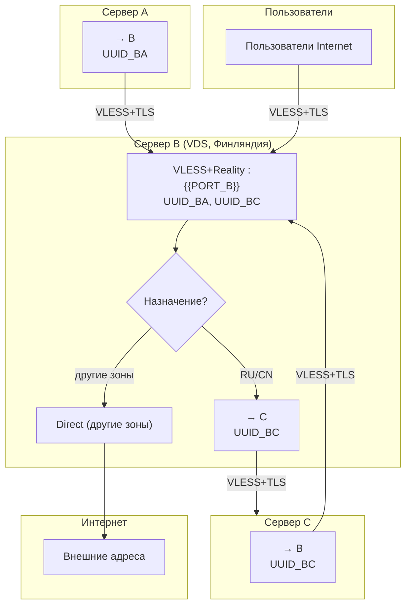
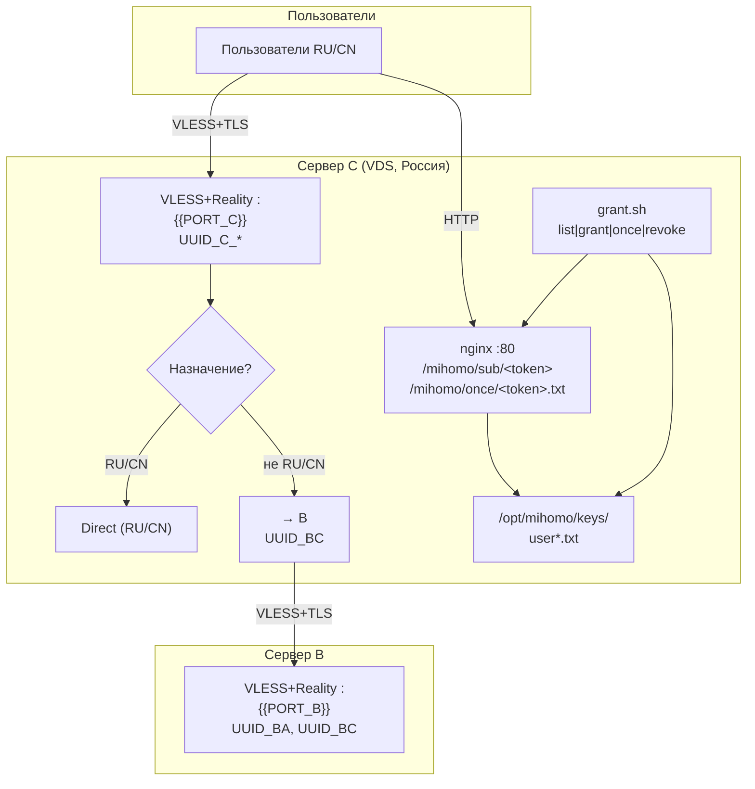
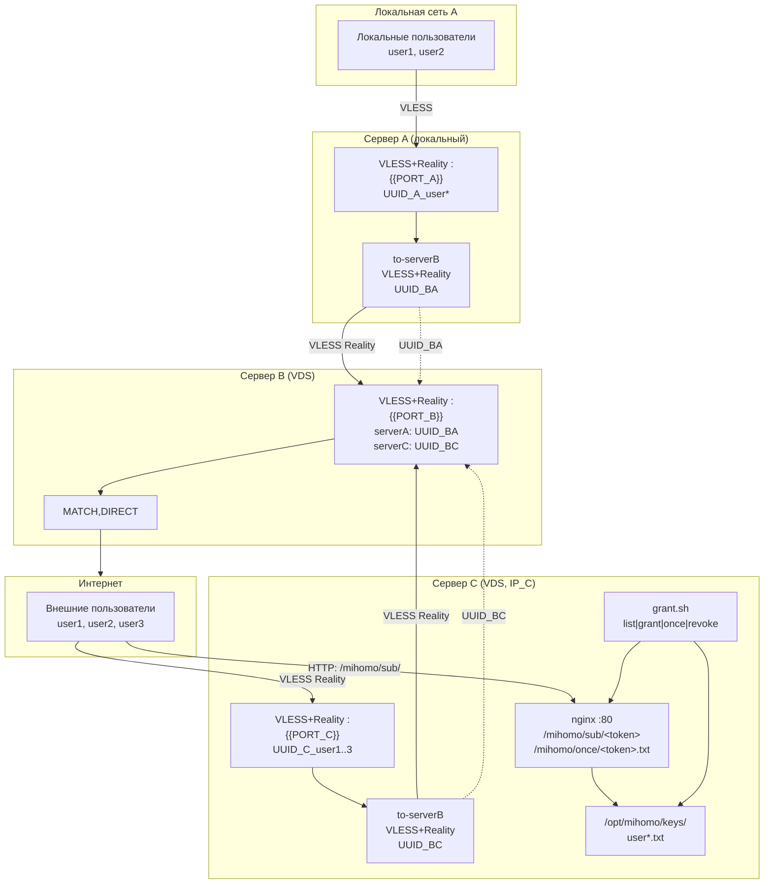

# Примеры конфигураций

[← Назад к README](../README.md)

---

## 1. Схема A-B-C

### 1.1 Общее описание

Международная компания ХХХ имеет два офиса: один в Хельсинки, второй в Москве. Сотрудники компании находятся в России, Финляндии и других странах. Заказчики, с которыми у сотрудников происходят контакты, находятся по всему миру. Штаб-квартира Службы ИТ компании ХХХ расположена в Москве и имеет свою локальную сеть и два VDS: один в Москве, другой в Хельсинки.

Необходимо построить систему доступа сотрудников к российским и мировым ресурсам. Начать нужно с локальной установки в России на базе российских ресурсов компании (сервер A). Потом развернуть сервер в Хельсинки (сервер B) и завершить развёртывание системы сервером в московском ЦОД (сервер C).

### 1.2 Результирующая схема

Сервер A — локальный, на компьютере разработчика, для тестирования и отладки. Позволяет подключаться пользователям из локальной сети, в которой расположен ПК разработчика.

Поток в интернет из сервера A пересылается в зависимости от геозоны назначения. Если назначение в зоне RU или CN — всё идёт Direct (прямое подключение). Остальной трафик идёт на сервер C, а если он недоступен — на сервер B.

Оба сервера A и C одновременно находятся в геозоне RU или CN. Сервер B — в геозоне FN (Финляндия).

Сервер B получает поток из серверов A, C и от пользователей геозоны, отличной от той, в которой находятся серверы A и C. Если назначение пакетов — в геозоне сервера C, то сервер B отправляет этот трафик в сервер C, остальной трафик — в Direct.

Сервер C получает поток из серверов A, B и от пользователей своей геозоны. Если назначение пакетов — в своей геозоне, сервер отправляет его Direct, остальной трафик уходит на сервер B.

Все потоки работают на протоколе VLESS+TLS.

### 1.3 Топология

| Сервер | Роль | Геозона | Runtime |
|---|---|---|---|
| A | Локальный шлюз | RU/CN | `.tmp/` |
| B | Релей | FN (Финляндия) | `/opt/mihomo/` |
| C | Внешний шлюз | RU/CN | `/opt/mihomo/` |

### 1.4 Диаграмма соединений



### 1.5 Пояснения к диаграмме

A — локальный ПК разработчика. Пользователи LAN → A.
A → Direct в зону RU/CN, если назначение RU/CN и если C недоступен; если C доступен — A → C.
A → B, если назначение не RU/CN.
A и C в геозоне RU/CN. B в геозоне ANY (не RU/CN).

B — VDS-сервер, локация Финляндия. Принимает поток из A (UUID_BA), из C (UUID_BC) и от пользователей Internet (U_Inet).
B → C, если назначение в геозоне RU/CN.
B → Direct (ANY_exit), если назначение в других зонах.

C — VDS-сервер, локация Россия. Принимает поток из A (не-RU/CN), из B (RU/CN) и от пользователей RU/CN.
C → Direct (RUCN_exit), если назначение в геозоне RU/CN.
C → B, если назначение не в RU/CN.

Все потоки — VLESS+TLS.

### 1.6 Легенда

- `-->` — основной поток
- `-.->` — fallback / альтернативный путь
- `{ромб}` — точка принятия решения
- `VLESS+TLS` — протокол передачи
- `$EDITOR` — текстовый редактор (`mcedit`, `vim` и т.д.)

### 1.7 Переменные схемы

| Переменная | Откуда | Пример |
|---|---|---|
| `PORT_A` | `build/keys/params.env` | `8443` |
| `PORT_B` | `build/keys/params.env` | `22443` |
| `PORT_C` | `build/keys/params.env` | `8443` |
| `IP_A` | `build/keys/params.env` | `192.168.10.88` |
| `IP_B` | `build/keys/params.env` | `103.x.x.152` |
| `IP_C` | `build/keys/params.env` | `94.232.248.179` |

Значения задаются в `build/keys/params.env`. Шаблон — `template/params.env.example`.
В `params.env` и `build/instances/*.env` указываются только буквальные
значения: подстановки переменных запрещены.
Списки `D_TO_B_INSTANCES` и `D_TO_C_INSTANCES` в `params.env` независимо
задают, какие экземпляры D могут подключаться к B и C.
Они управляют VLESS-выходами D и соответствующими учётками на B/C, но не
reverse SSH-туннелем D → C для управления.

### 1.8 UUID-схема

| UUID | Кто использует | Где генерируется |
|---|---|---|
| `UUID_A_user1`, `UUID_A_user2` | Пользователи LAN → A | `scripts/build-servers.sh`, `ensure_key A_user1` |
| `UUID_C_user1`, `UUID_C_user2`, `UUID_C_user3` | Пользователи RU/CN → C | `scripts/build-servers.sh`, `ensure_key C_user1` |
| `UUID_BA` | A → B (релей) | `scripts/build-servers.sh`, `ensure_key BA` |
| `UUID_BC` | C → B (релей) | `scripts/build-servers.sh`, `ensure_key BC` |

UUID A/B/C и экземпляра D хранятся в `build/keys/keys.env` (в `.gitignore`).
Дополнительные экземпляры D получают отдельные файлы
`build/instances/<ID>.keys.env`.

### 1.9 Логика маршрутизации

#### 1.9.1 Сервер A

Вход — VLESS+Reality на `PORT_A` (см. `template/config_A.yaml.j3`).
Правила (в `template/config_A.yaml.j3`, `rules:`):

- `GEOIP,CN,DIRECT,no-resolve`
- `GEOIP,RU,DIRECT,no-resolve`
- `GEOIP,private,DIRECT,no-resolve`
- `MATCH,PROXY`

`PROXY` — группа `select` с `to-serverB` и `DIRECT`. При недоступности C трафик уходит в B через `to-serverB` (UUID_BA).

#### 1.9.2 Сервер B

Вход — VLESS+Reality на `PORT_B` (см. `template/config_B.yaml.j3`). Принимает `UUID_BA` (от A) и `UUID_BC` (от C), а также пользователей Internet.

Целевая логика B (для реализации полной схемы, см. диаграмму 1.4):

```yaml
proxies:
  - name: "to-serverC"
    type: vless
    server: {{ IP_C }}
    port: {{ PORT_C }}
    uuid: "{{ UUID_BC }}"
    flow: {{ FLOW_AB }}
    tls: true
    servername: www.microsoft.com
    reality-opts:
      public-key: "{{ PUBLIC_KEY_C }}"
      short-id: "{{ SHORT_ID_C }}"
    client-fingerprint: chrome
    udp: false

proxy-groups:
  - name: PROXY
    type: select
    proxies:
      - to-serverC
      - DIRECT

rules:
  - GEOIP,CN,PROXY,no-resolve
  - GEOIP,RU,PROXY,no-resolve
  - GEOIP,private,DIRECT,no-resolve
  - MATCH,DIRECT
```

То есть B → C для RU/CN, B → Direct для всего остального.

Текущий `template/config_B.yaml.j3` содержит только `MATCH,DIRECT`. Для реализации полной схемы шаблон B нужно дополнить группой `PROXY` и правилами GEOIP (по аналогии с `config_C.yaml.j3`).

#### 1.9.3 Сервер C

Вход — VLESS+Reality на `PORT_C` (см. `template/config_C.yaml.j3`). Принимает `UUID_C_user1..3` (от пользователей RU/CN), а также поток из A и B.
Правила (в `template/config_C.yaml.j3`, `rules:`):

- `GEOIP,CN,DIRECT,no-resolve`
- `GEOIP,RU,DIRECT,no-resolve`
- `GEOIP,private,DIRECT,no-resolve`
- `MATCH,PROXY`

`PROXY` — группа `select` с `to-serverB` (UUID_BC) и `DIRECT`. Не-RU/CN трафик уходит на B.

---

## 2. Реализация проекта

### 2.1 Используемые порты

| Порт | Назначение |
|---|---|
| `PORT_A` (8443) | VLESS+Reality на A |
| `PORT_B` (22443) | VLESS+Reality на B |
| `PORT_C` (8443) | VLESS+Reality на C |
| `7890` | mixed-port (HTTP/SOCKS5) на всех серверах |
| `7895` | port (HTTP) на A и C |
| `7896` | socks-port на A и C |
| `7893` | tproxy-port (прозрачный прокси) |
| `9900` | external-controller (API mihomo) |
| `8000` | веб-панель `mihomo-manager` на A |
| `1053` | DNS на всех серверах |
| `80` | nginx на C (выдача подписок) |

### 2.2 Этап 1. Установка сервера A

#### 2.2.1 Команды сборки и запуска

```
cp template/params.env.example build/keys/params.env
$EDITOR build/keys/params.env
./scripts/build-servers.sh A --build
./build-local.sh start
```

После запуска A доступен на `http://localhost:8000` (панель управления) и `http://localhost:9900/ui` (MetaCubeXD).

#### 2.2.2 Схема установки сервера A



#### 2.2.3 Описание разворачивания

1. Копируется `template/params.env.example` в `build/keys/params.env`, редактируются IP, порты, имена пользователей.
2. `./scripts/build-servers.sh A --build` генерирует ключи для A (`ensure_key A`, `ensure_key A_user1`, `ensure_key A_user2`), рендерит `build/A/config.yaml` из `template/config_A.yaml.j3`, копирует его в `.tmp/config.yaml`.
3. `./build-local.sh start` запускает ядро mihomo и `mihomo-manager` в фоне.

### 2.3 Этап 2. Установка сервера B

#### 2.3.1 Команды

```
./scripts/build-servers.sh B --build
# затем деплой на B (scp + systemctl restart mihomo)
```

#### 2.3.2 Схема установки сервера B



#### 2.3.3 Описание разворачивания

1. `./scripts/build-servers.sh B --build` генерирует ключи для B (`ensure_key B`, `ensure_key BA`, `ensure_key BC`), рендерит `build/B/config.yaml` из `template/config_B.yaml.j3`.
2. Файл копируется на B в `/opt/mihomo/config.yaml` через `scp`.
3. На B перезапускается служба mihomo: `systemctl restart mihomo`.

### 2.4 Этап 3. Установка сервера C

#### 2.4.1 Команды

```
./scripts/build-servers.sh C --build
# затем деплой на C (scp + systemctl restart mihomo)
# затем настройка nginx и grant.sh на C
```

#### 2.4.2 Схема установки сервера C



#### 2.4.3 Описание разворачивания

1. `./scripts/build-servers.sh C --build` генерирует ключи для C (`ensure_key C`, `ensure_key C_user1..3`, `ensure_key BC`), рендерит `build/C/config.yaml` из `template/config_C.yaml.j3`, а также `build/users/C_user*.yaml`, `build/users/C_user*.txt` и `build/web/C_user*.txt` (base64).
2. Файл `build/C/config.yaml` копируется на C в `/opt/mihomo/config.yaml` через `scp`.
3. Файлы `build/web/*.txt` копируются на C в `/opt/mihomo/keys/` (приватное хранилище).
4. На C настраивается nginx: `root /var/www/html;`, `location /mihomo/sub/`, `location /mihomo/once/`. Каталог `/opt/mihomo/keys/` — вне root nginx, доступ к нему невозможен.
5. На C создаётся `/opt/mihomo/grant.sh` (см. `scripts/grant.sh`) для выдачи доступа: `grant.sh list | grant <user> | once <user> [ttl] | revoke <user> | list-tokens`.
6. Перезапускается служба mihomo на C.

Для нескольких серверов типа D см. [раздел о D-экземплярах](D-deployment.md#11-несколько-экземпляров-типа-d): у каждого свои overlay-настройки, ключи и порт reverse-туннеля на C.

### 2.5 Финальное тестирование

#### 2.5.1 Проверка

```
A: ss -tlnp | grep 8443
B: ss -tlnp | grep 22443
C: ss -tlnp | grep 8443
```

Клиент: `curl -x socks5://127.0.0.1:7890 https://www.google.com`

#### 2.5.2 Проверка выдачи подписок на C

```
curl http://<IP_C>/mihomo/sub/<token>      # постоянный токен
curl http://<IP_C>/mihomo/once/<token>.txt # одноразовый токен
curl http://<IP_C>/mihomo/keys/            # должно вернуть 404
```

#### 2.5.3 Проверка маршрутизации

- Клиент в RU/CN → C → Direct (RU/CN-ресурсы) или C → B (не-RU/CN).
- Клиент в других геозонах → B → Direct (для не-RU/CN назначений) или B → C (для RU/CN назначений).
- Пользователи LAN → A → Direct (RU/CN) или A → C (не-RU/CN), при недоступности C → A → B.

---

## 3. Черновик (устаревшее)

> ⚠️ Этот раздел устарел и оставлен для истории. Актуальная схема — в разделе 1.



---

## 4. Смотрите также

- [architecture.md](architecture.md) — структура проекта
- [deployment.md](deployment.md) — публикация
- [clients.md](clients.md) — подключение клиентов
- [configuration.md](configuration.md) — переменные `.env`
- [../todo.md](../todo.md) — открытые вопросы по схеме